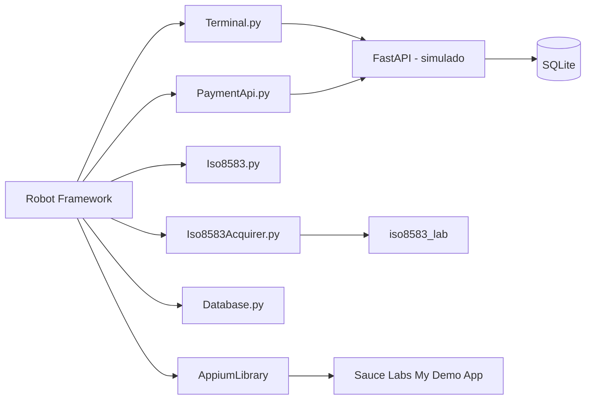

# POS QA Lab — Robot Framework + Python

[](https://github.com/PaulinoLogicLab/pos-qa-lab/actions/workflows/robot.yml)
[](LICENSE)

Laboratório público de qualidade para uma **jornada de pagamento simulada** e um **terminal Android de demonstração**.
O objetivo é exercitar, com evidência, o tipo de falha que aparece em POS: timeout, perda de conexão, retry,
idempotência, cancelamento, estorno, parcelamento, reinício e atualização de aplicativo.

> **Escopo e honestidade:** este projeto é um laboratório. Não é um POS real, não se conecta a adquirente,
> não implementa EMV, ISO 8583 de produção ou PCI PTS e não tem afiliação com a Stone. Os dados são sintéticos.

## Resultado atual

| Métrica | Valor |
|---|---:|
| Casos Robot executados | **37** |
| Aprovados | **37** |
| Reprovados | **0** |
| Tempo somado dos casos | **4,01 s (núcleo/ISO) + 104,69 s (device)** |
| Testes unitários Python | **39 aprovados** |
| Casos de dispositivo | **5/5 aprovados em emulador Android 16** |
| Defeitos do laboratório corrigidos | **3** (+5 achados de automação/implementação) |
| CI | **32/32 no Ubuntu + Python 3.12** |

Detalhes em [relatório de execução](docs/05_relatorio-execucao.md) e [relatório de defeitos](docs/06_relatorio-defeitos.md).

**Evidências versionadas:** [índice](docs/evidencias/README.md) · [núcleo/ISO](docs/evidencias/core-2026-11-19/summary.json) · [device](docs/evidencias/device-2026-11-19/summary.json)

## O que o projeto cobre

- **Venda** aprovada e negada, com código de resposta.
- **Cancelamento** antes da captura.
- **Pré-autorização + captura** total e parcial.
- **Estorno** total e parcial, limitado ao valor capturado.
- **Parcelamento** com arredondamento de centavos.
- **Liquidação/fechamento** por terminal, com bruto, estorno e líquido.
- **Idempotência** por `Idempotency-Key`, inclusive sob concorrência.
- **Timeout + retry** sem duplicar transação.
- **Fila offline** em SQLite e sincronização.
- **Reinício do terminal** preservando a fila.
- **Contratos de erro** (400/422/409) e `correlation_id` em API, banco e evento.
- **ISO 8583**: MTI, bitmap, campos fixos/LLVAR, `0100/0110`, `0400/0410` e `0800/0810`.
- **Android**: login, validação, carrinho, background/foreground e atualização de APK.

## Arquitetura



- `src/api`: API FastAPI, regras de pagamento, idempotência, eventos e refunds.
- `src/terminal`: simulador de terminal com fila offline persistida em SQLite.
- `libraries`: bibliotecas Robot que isolam HTTP, banco, estado e parsing.
- `robot/suites`: 32 casos de negócio, resiliência, captura/liquidação, concorrência e ISO 8583.
- `robot/device`: smoke de dispositivo no app público.
- `iso8583_lab`: parser/construtor limitado a ASCII e dados sintéticos.

## Quickstart

```bash
python -m venv .venv
# Windows
.venv\Scripts\activate
# Linux/macOS
source .venv/bin/activate

pip install -r requirements.txt
python scripts/run_suite.py --exclude device
```

Relatórios:

- `reports/robot/report.html`
- `reports/robot/log.html`
- `reports/robot/output.xml`
- `reports/robot/summary.json`
- `reports/robot/api.log`

Testes unitários:

```bash
pytest
```

Rodar apenas um grupo:

```bash
python scripts/run_suite.py --include resilience
python scripts/run_suite.py --include iso8583
python scripts/run_suite.py --include contract
```

## Device suite

**Resultado:** 5/5 aprovados em 19/11/2026 no emulador `Pixel_8_Pro`
(`sdk_gphone64_x86_64`, Android 16 / API 36), com My Demo App 2.3.0, Appium 3.5.0 e
UiAutomator2 7.0.0. Tempo dos casos: 104,69 s.

Pré-requisitos: Android SDK/`adb`, emulador ou dispositivo, Appium 2+ e `UiAutomator2`.

```bash
pip install -r requirements-device.txt
python scripts/download_demo_app.py
appium --address 127.0.0.1 --port 4723
```

Windows PowerShell:

```powershell
$env:RUN_DEVICE_TESTS="1"
python scripts/run_suite.py --device --no-api --outputdir reports/device_run
```

Atualização de APK (evidência de install/update):

```bash
python scripts/device_upgrade_check.py --old device/apps/<antigo>.apk --new device/apps/<novo>.apk
```

O script instala a versão antiga, abre o app, instala a nova com `adb install -r`, verifica se o processo
continua vivo e salva `reports/device/upgrade-check.txt` e o `logcat`. Ele ainda não foi executado.

## Estrutura

```text
pos-qa-lab/
  docs/                 # escopo, plano, casos, matriz, execução, defeitos, limitações
  src/api/              # FastAPI + SQLite
  src/terminal/         # simulador com fila offline
  iso8583_lab/          # parser/construtor didático
  libraries/            # bibliotecas Robot
  robot/suites/         # 32 casos de núcleo, captura/liquidação, concorrência e ISO
  robot/device/         # 5 casos de dispositivo
  tests/                # 39 testes unitários
  scripts/              # runner, resumo, download e upgrade
```

## Limitações

- Adquirente, terminal e dados são simulados.
- ISO 8583 é um laboratório de formato: ASCII, sem BCD, MAC ou rede.
- A suíte de dispositivo está implementada, mas **não foi executada** neste ambiente por ausência de
  emulador/Appium; o README explica como reproduzir.
- Não há teste de impressão térmica, pinpad, EMV ou certificação de bandeira.
- Não há autenticação na API do laboratório.

## Documentação

- [Escopo e riscos](docs/01_escopo-e-riscos.md)
- [Plano de teste](docs/02_plano-de-teste.md)
- [Casos de teste](docs/03_casos-de-teste.md)
- [Matriz de rastreabilidade](docs/04_matriz-rastreabilidade.md)
- [Relatório de execução](docs/05_relatorio-execucao.md)
- [Relatório de defeitos](docs/06_relatorio-defeitos.md)
- [Limitações](docs/07_limitacoes.md)

## Licença

MIT. Veja [LICENSE](LICENSE).
